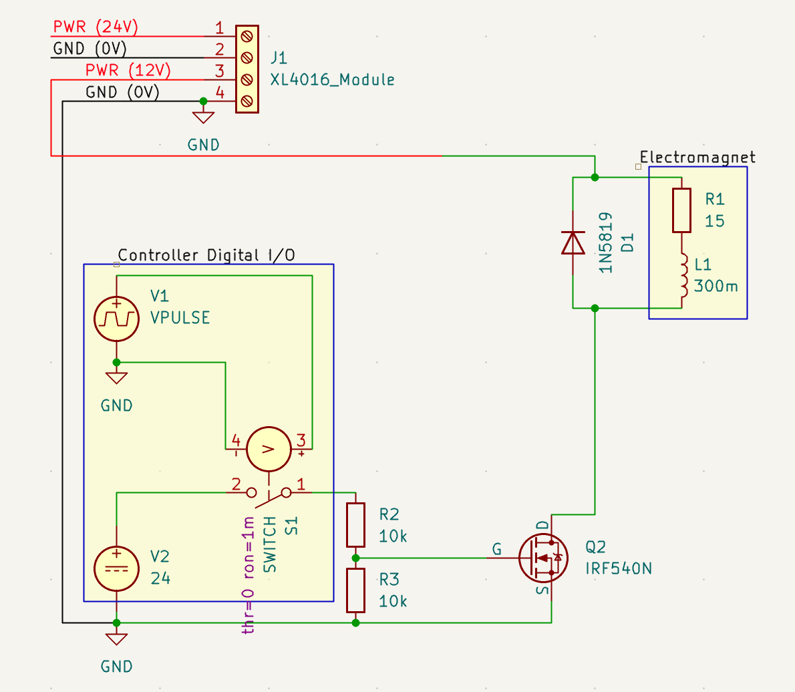
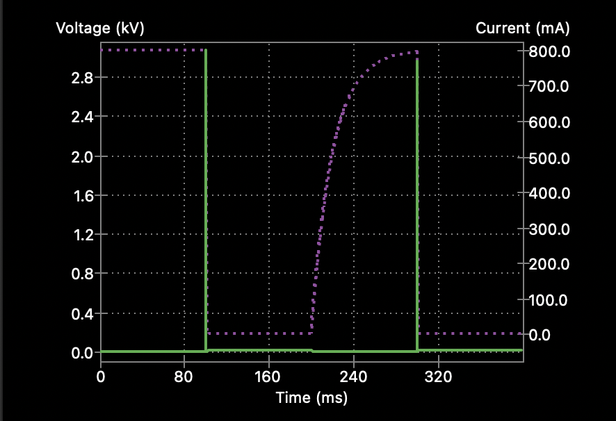
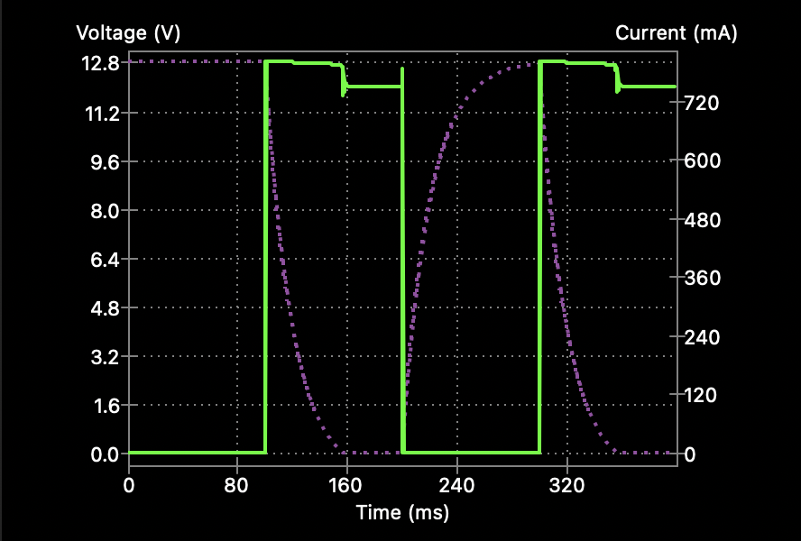
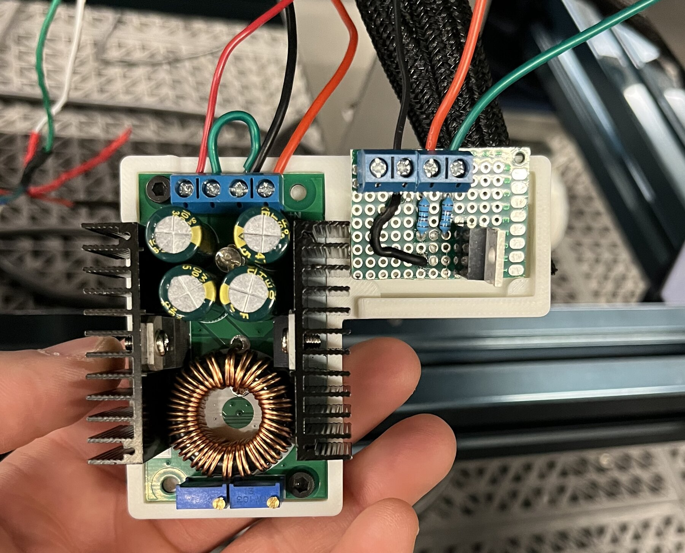
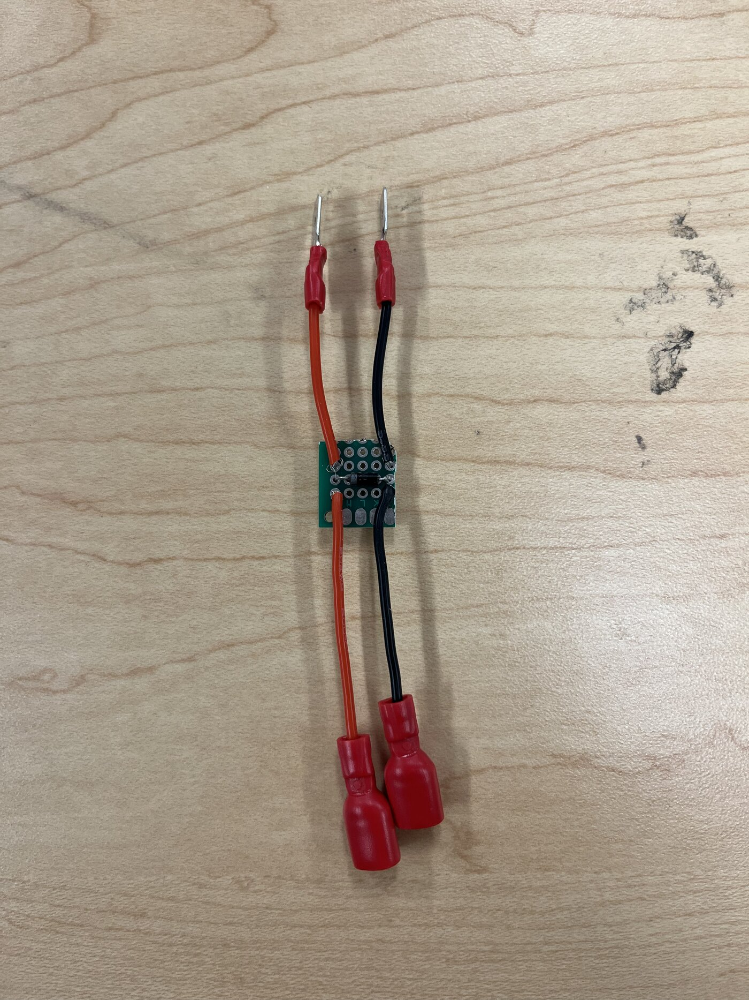

# Driver Circuit

The driver circuit powers the electromagnet from the UR5e control box and switches it on and off from a controller digital output.

## How it works

- **Power.** The controller's PWR terminal supplies 24 V to an XL4016 buck converter module, which steps it down to the 12 V the magnet needs.
- **Switching.** The magnet sits between the 12 V output and the drain of an IRF540N MOSFET. A 24 V controller digital output drives the gate through two 10 kΩ resistors in a divider, which holds the gate at about 12 V when the output is on.
- **Flyback diode.** The magnet is a coil, so when the MOSFET turns off its current has nowhere to go and the voltage across the coil spikes. A 1N5819 diode across the magnet gives that current a path and protects the MOSFET.

*Figure 1. KiCad schematic of the driver circuit. The magnet is modelled as a 15 Ω resistance in series with a 300 mH inductance.*

## Simulation

The circuit was simulated in KiCad with the MOSFET switching the magnet on and off, first without and then with the flyback diode. Without the diode, the voltage spikes to about 3 kV when the MOSFET turns off, far above the IRF540N's 100 V drain-source rating, and the magnet current drops to zero immediately. With the diode, the voltage rises to about 12.8 V and stays there, and the current decays gradually.

*Figure 2. Simulated voltage (green) and magnet current (purple, dotted) without the flyback diode.*

*Figure 3. Simulated voltage (green) and magnet current (purple, dotted) with the flyback diode.*

## Built circuit

*Figure 4. The buck converter (left) and the MOSFET driver board (right) on their 3D-printed mount.*

Wires entering the top of Figure 4, left to right:

| Board | Wire colour | Connects to |
|---|---|---|
| Buck converter | Red | 12 V output, to the magnet |
| Buck converter | Black | Ground |
| Buck converter | Red | 24 V input, from the controller's PWR terminal |
| MOSFET driver | Black | 0 V |
| MOSFET driver | Red | 24 V digital output from the controller |
| MOSFET driver | Green | Magnet negative |

*Figure 5. Flyback diode board. The wires from the driver circuit connect at one end and the magnet's + and − terminals at the other, with the diode across the two.*
