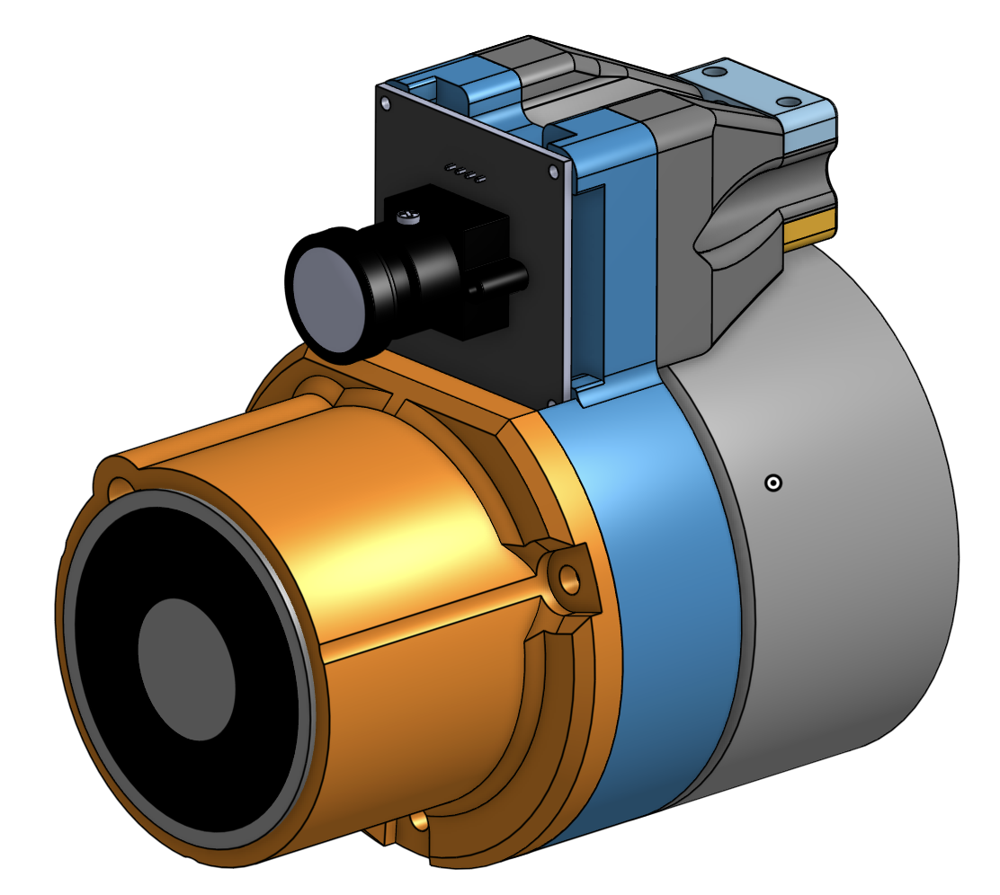
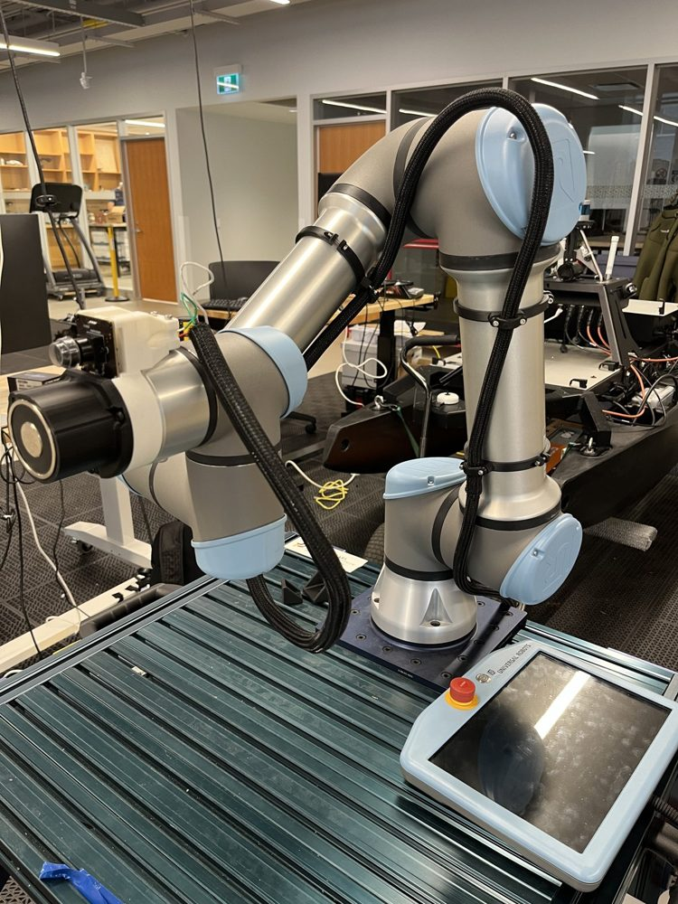
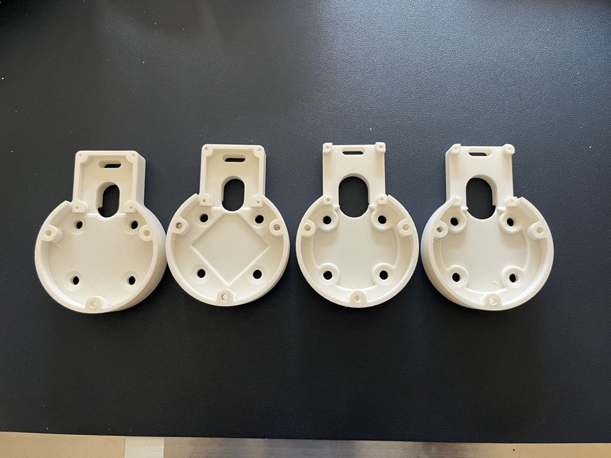
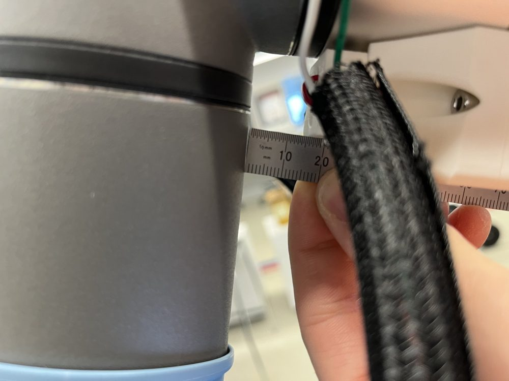
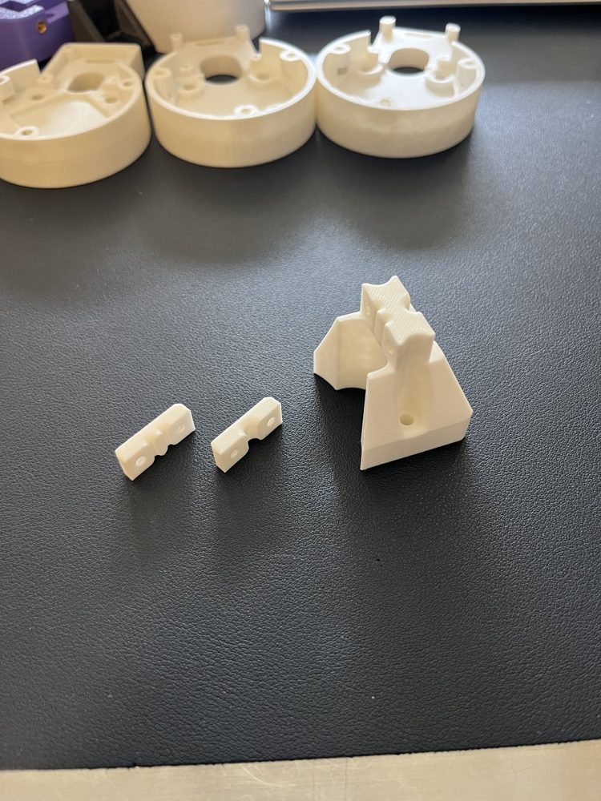

# Mechanical design

The mechanical design holds the electromagnet and the camera on the end of the UR5e arm and carries their wiring along the arm. The parts are 3D printed. The CAD is in Onshape, and the STEP files are in [`cad/`](cad/).

*Figure 1. The assembled end effector in Onshape, with the electromagnet and the camera board.*

## Parts

| Part | What it does |
|---|---|
| Master bracket | Bolts to the end of the arm. Holds the camera and provides the mounting points for the secondary bracket and the wire relief clamps. |
| Secondary bracket | Mounts to the master bracket and holds the electromagnet. The space between the two brackets holds the wire connections and the flyback diode. |
| Wire relief clamps | Mount to the master bracket and clamp the camera wires and the electromagnet's + and − supply wires so that pulling on the cable does not load the connections. The main part is the guide that mounts to the master bracket. The camera and power parts screw together on either side of it to secure the camera wires and the + and − supply wires. |
| Board mount | Printed mount for the buck converter and MOSFET driver board. It is the mount shown in Figure 4 of the [driver circuit](driver-circuit.md). |
| Dress clamps | A full circle with a split in it, tightened onto the robot limb with a bolt. There are two sizes, 75 mm for the upper arm and 85 mm for the lower arm, and two of each are used. |
| Dress clips | A semicircle that bolts into a dress clamp and secures the wire dressing to the arm. One clip per clamp, in the matching size. |

*Figure 2. The end effector on the UR5e, with the braided wire sleeve running along the arm.*

## Fasteners

The fastener depends on the load the part has to carry. Structural parts, such as the clamps and the magnet mounts, are bolted through and threaded into nuts. Light-load connections, such as the M2 screws holding the camera board, are threaded directly into the plastic.

## Master bracket iterations

The master bracket was printed several times. The changes between prints were small: tolerances on the threads, and the fit of the camera that was ordered. The overall design did not change, and the CAD in [`cad/master_bracket.step`](cad/master_bracket.step) is the final version. The individual prints were not saved, so the photo shows the four variants that were kept.

*Figure 3. Four printed variants of the master bracket.*

## Test build

The current build is a test build, tested by hand. Two things came out of it, both listed in the [open issues](../README.md#open-issues): the wire relief clamps bend the cable sharply, and the magnet warms the PLA mount.

### Wire relief clamp bend

When wrist 3 is at −π, the cable is bent sharply where it leaves the wire relief clamp. The bend is visibly sharp and is hard on the wire and on the connection the clamp is meant to protect.

*Figure 4. The braided sleeve bent sharply next to the wrist, with a ruler for scale.*

*Figure 5. The current printed wire relief clamp: the two small parts that screw on either side (left) and the main part that mounts to the master bracket (right).*

An angled exit from the clamp is being considered to give the cable a gentler bend. It has not been designed or tested yet.

## Files

| File | What it is |
|---|---|
| [`cad/master_bracket.step`](cad/master_bracket.step) | Master bracket |
| [`cad/secondary_bracket.step`](cad/secondary_bracket.step) | Secondary bracket |
| [`cad/wire_relief_clamp_camera.step`](cad/wire_relief_clamp_camera.step), [`_power`](cad/wire_relief_clamp_power.step), [`_main`](cad/wire_relief_clamp_main.step) | Wire relief clamps. The main part mounts to the master bracket, and the camera and power parts screw on either side of it |
| [`cad/dress_clamp_75mm.step`](cad/dress_clamp_75mm.step), [`dress_clip_75mm.step`](cad/dress_clip_75mm.step) | Dress clamp and clip for the 75 mm upper arm |
| [`cad/dress_clamp_85mm.step`](cad/dress_clamp_85mm.step), [`dress_clip_85mm.step`](cad/dress_clip_85mm.step) | Dress clamp and clip for the 85 mm lower arm |
| [`cad/supply_isolation_mount.step`](cad/supply_isolation_mount.step) | Board mount for the buck converter and MOSFET driver board |

Each file is one part exported from Onshape as STEP. The overall assembly is not exported, so Figure 1 is the only view of the parts together.
