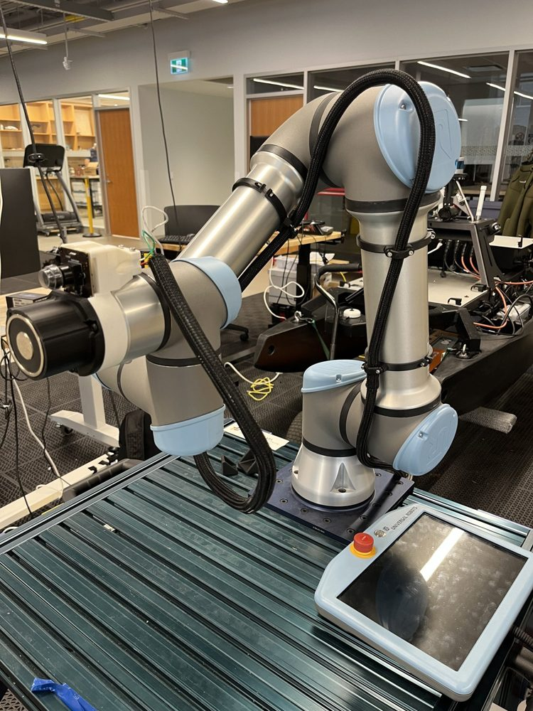

# End Effector

**Owner:** Ryan Donen

The end effector is everything mounted on the end of the UR5e arm that lets it find, grip and release a tool, plus the systems needed to run it. It has three parts:

- **End-of-arm tooling.** A 50 mm electromagnet (ZYE1-P49, rated 400 N, 12 V DC, 0.84 A) that grips the steel end of a screwdriver, and the wrist-mounted eye-in-hand camera used to find tools on the rack and confirm the tool is on the magnet.
- **Power and drive circuit.** The robot control box supplies 24 V, a buck converter steps it down to the magnet's 12 V, and a MOSFET switches the magnet on and off. A controller digital output drives the MOSFET, and a flyback diode across the magnet absorbs the voltage spike when it switches off.
- **Wire management and dressing.** Wire relief clamps, dress clamps and clips carry the magnet and camera wiring along the arm without loading the connections, and a printed mount holds the driver circuit boards.

*Figure 1. The end effector mounted on the UR5e wrist, with the braided wire sleeve running along the arm.*

## Requirements it serves

Requirement numbers are from the project proposal (Table 2).

- **R3**: hold payloads up to 0.45 kg with no slip during motion. This is the main requirement for this subsystem. The tools weigh about 0.15 kg, so 0.45 kg gives a safety factor of 3.
- **R5**: correct tool picked up in at least 96% of attempts. The magnet has to grip the tool reliably once the arm is in position, and the wrist camera has to see the tool and confirm it is on the magnet.
- **R2**: successful handoff in at least 80% of trials. Releasing the tool means switching the magnet off. Deciding when to switch it off is outside this subsystem.
- **R4**: three distinct tools. All three screwdrivers have steel ends, so one magnet picks up each of them.
- **R7**: setup and operation documented well enough for someone outside the team. The wiring, dressing and driver circuit have to be reproducible from this folder.
- **Safety (proposal section 5.0)**: emergency-stop behaviour must be checked for end-effector operation, including whether losing tool power could drop an object. This drives the choice of where the magnet is powered from. Testing confirmed that the magnet keeps its state through an emergency stop.

## Status

- The electromagnet, driver circuit and mount are built and have been tested by hand. No formal experiments have been run yet.
- R3 is not yet verified. The proposal calls for a bench test at 0.45 kg, and the feasibility calculation will set what to expect from it.

## What's in this folder

| Folder | Contents |
|---|---|
| [`01_requirements/`](01_requirements/) | End-effector requirements taken from R2, R3, R5 and R7, each with its rationale and test |
| [`02_decisions/`](02_decisions/) | [Electromagnet](02_decisions/electromagnet.md) · [Power architecture](02_decisions/power-architecture.md) |
| [`03_calculations/`](03_calculations/) | [Magnet feasibility](03_calculations/magnet-feasibility.md): whether the magnet can hold a 1/4 inch (6.35 mm) steel shaft without slipping, checked for vertical and horizontal lift |
| [`04_design/`](04_design/) | [Mechanical design](04_design/mechanical-design.md): brackets, wire relief clamps, dress clamps and clips, with the STEP files in [`cad/`](04_design/cad/) · [Driver circuit](04_design/driver-circuit.md): KiCad schematic, simulation with and without the flyback diode, photos of the built circuit, and the wire connections |
| [`05_code/`](05_code/) | Empty for now. The magnet is switched from the teach pendant |
| [`06_experiments/`](06_experiments/) | Empty for now. Notes from the test build are in the [mechanical design](04_design/mechanical-design.md#test-build) |
| [`08_references/`](08_references/) | UR5e user manual (v5.8), [ZYE1-P series electromagnet datasheet](https://static.chipdip.ru/lib/802/DOC033802024.pdf) |
| [`09_figures/`](09_figures/) | Figures used in this section, including the KiCad schematic |

## Open issues

- **The wire relief clamps bend the cable sharply.** The clamps hold the cable so that pulling on it does not load the connections. With wrist 3 at −π, the cable is bent visibly sharply where it leaves the clamp ([photo](04_design/mechanical-design.md#wire-relief-clamp-bend)). It is hard on the wire and on the connection the clamp is meant to protect.
- **The magnet gets warm enough to soften the PLA mount.** The mount currently encases the magnet completely in plastic, which may be trapping heat. These tests switched the magnet on and off from the teach pendant, so it stayed on for long periods at a much higher duty cycle than it will see in use. If the robot is moving tools constantly, the duty cycle will be 50% at most. The warming under realistic use is still unknown.

## Next steps

1. Redesign the wire relief clamps so the cable keeps a gentler bend when wrist 3 rotates into those positions. An angled exit from the clamp is the option being considered; it has not been designed or tested.
2. Watch how warm the magnet gets at duty cycles closer to real use, up to 50%, and note what is seen in the [test build notes](04_design/mechanical-design.md#test-build).
3. If the magnet still heats up under realistic use, pick one or both:
   - Print the mount in PETG or ABS, which soften at higher temperatures than PLA.
   - Add passive cooling by leaving more of the magnet exposed, or by fastening heat sinks to the magnet's body.
4. Run the 0.45 kg bench test for R3, using the feasibility calculation as the expected result.
