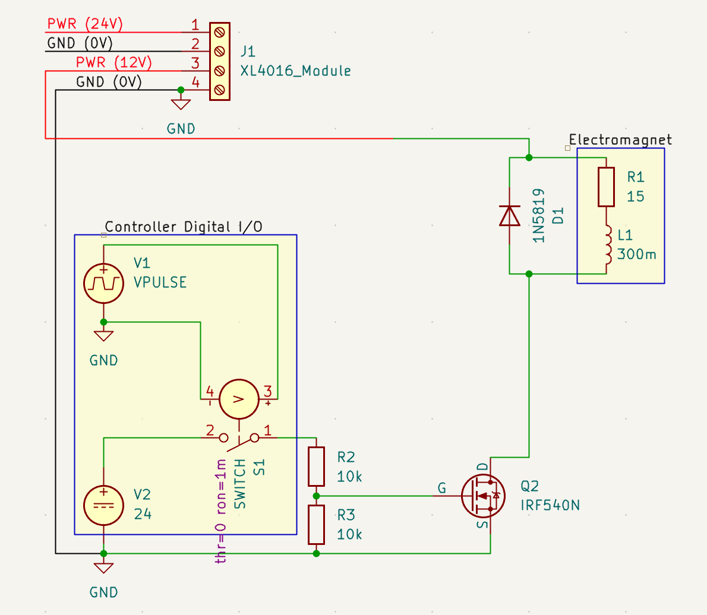
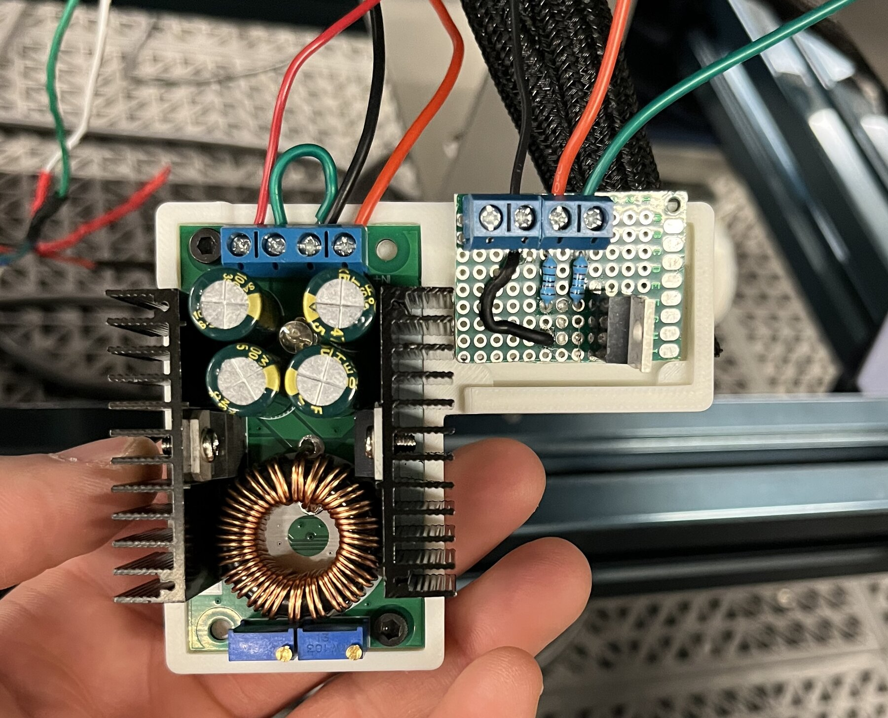
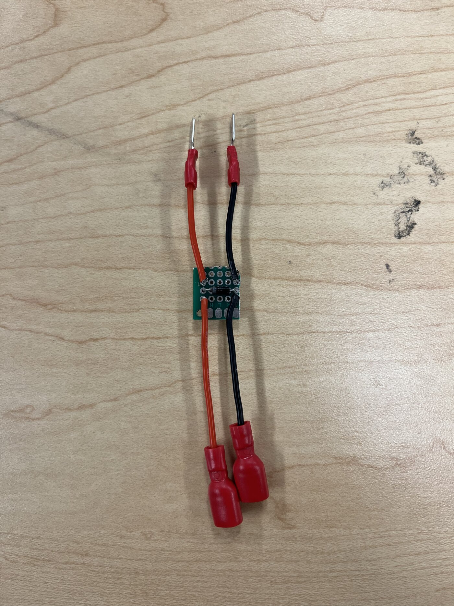

# End Effector

**Owner:** Ryan Donen

The end effector is everything mounted on the end of the UR5e arm that lets it find, grip and release a tool, plus the systems needed to run it. It has three parts:

- **End-of-arm tooling.** A 50 mm electromagnet (ZYE1-P49, rated 400 N, 12 V DC, 0.84 A) that grips the steel end of a screwdriver, and the wrist-mounted eye-in-hand camera used to find tools on the rack and confirm the tool is on the magnet.
- **Power and drive circuit.** The robot control box supplies 24 V, a buck converter steps it down to the magnet's 12 V, and a MOSFET switches the magnet on and off. A controller digital output drives the MOSFET, and a flyback diode across the magnet absorbs the voltage spike when it switches off.
- **Wire management and dressing.** Strain-relief clamps, cable clips and a control box board mount that carry the magnet and camera wiring along the arm without loading the connections.

*Figure 1. KiCad schematic of the driver circuit, with a SPICE transient simulation of the switched magnet.*

*Figure 2. Built circuit: the buck converter (left) and the MOSFET driver board (right) on their 3D-printed mount.*

Wires entering the top of Figure 2, left to right:

| Board | Wire colour | Connects to |
|---|---|---|
| Buck converter | Red | 12 V output, to the magnet |
| Buck converter | Black | Ground |
| Buck converter | Red | 24 V input, from the controller's PWR terminal |
| MOSFET driver | Black | 0 V |
| MOSFET driver | Red | 24 V digital output from the controller |
| MOSFET driver | Green | Magnet negative |

*Figure 3. Flyback diode board. The wires from the driver circuit connect at one end and the magnet's + and − terminals at the other, with the diode across the two.*

## Requirements it serves

Requirement numbers are from the project proposal (Table 2).

- **R3**: hold payloads up to 0.45 kg with no slip during motion. This is the main requirement for this subsystem. The tools weigh about 0.15 kg, so 0.45 kg gives a safety factor of 3.
- **R5**: correct tool picked up in at least 96% of attempts. The magnet has to grip the tool reliably once the arm is in position, and the wrist camera has to see the tool and confirm it is on the magnet.
- **R2**: successful handoff in at least 80% of trials. Releasing the tool means switching the magnet off when the operator pulls on it. The pull will be detected with force sensing, which is not implemented yet.
- **R4**: three distinct tools. All three screwdrivers have steel ends, so one magnet picks up each of them.
- **R7**: setup and operation documented well enough for someone outside the team. The wiring, dressing and driver circuit have to be reproducible from this folder.
- **Safety (proposal section 5.0)**: emergency-stop behaviour must be checked for end-effector operation, including whether losing tool power could drop an object. This drives the choice of where the magnet is powered from. Testing confirmed that the magnet keeps its state through an emergency stop.

## Status

- The electromagnet, driver circuit and mount are built and have been tested by hand. No formal experiments have been run yet.
- R3 is not yet verified. The proposal calls for a bench test at 0.45 kg, and the feasibility calculation will set what to expect from it.
- Release by force sensing is not implemented. The plan is to use the UR5e's built-in wrist force/torque sensing rather than buy a separate sensor, which is outside the budget. With the magnet on, a pull against the wrist above a threshold would switch it off.

## What's in this folder

| Folder | Contents |
|---|---|
| [`01_requirements/`](01_requirements/) | End-effector requirements taken from R2, R3, R5 and R7, each with its rationale and test |
| [`02_decisions/`](02_decisions/) | [Why an electromagnet](02_decisions/electromagnet.md) · [Driver and power architecture](02_decisions/driver-and-power.md) · [Release sensing](02_decisions/release-sensing.md) |
| [`03_calculations/`](03_calculations/) | Magnet feasibility: how much the magnet can lift from a 1/4 inch (6.35 mm) steel shaft, checked for slipping in vertical lift and in horizontal lift. Camera field-of-view check |
| [`04_design/`](04_design/) | Circuit schematic and KiCad simulation, with voltage traces with and without the flyback diode |
| [`05_code/`](05_code/) | Empty for now. The magnet is switched from the teach pendant |
| [`06_experiments/`](06_experiments/) | Build log and test notes |
| [`08_references/`](08_references/) | UR5e user manual (v5.8), [ZYE1-P series electromagnet datasheet](https://static.chipdip.ru/lib/802/DOC033802024.pdf) |
| [`09_figures/`](09_figures/) | Circuit schematic and simulation, and photos of the built circuit |

## Open issues

- **The strain-relief clamps force a hard 90° bend in the cable.** The clamps hold the cable so that pulling on it does not load the connections. In some arm configurations the cable leaves the clamp at a sharp 90° bend, which is hard on the wire and the connection the clamp is meant to protect. Which configurations cause it has not been recorded yet.
- **The magnet gets warm enough to soften the PLA mount.** The mount currently encases the magnet completely in plastic, which may be trapping heat. These tests switched the magnet on and off from the teach pendant, so it stayed on for long periods at a much higher duty cycle than it will see in use. If the robot is moving tools constantly, the duty cycle will be 50% at most. The warming under realistic use is still unknown.

## Next steps

1. Photograph the arm configurations that put the cable into a 90° bend and note them in the build log in [`06_experiments/`](06_experiments/). Then redesign the strain-relief clamps so the cable keeps a gentler bend in those configurations.
2. Watch how warm the magnet gets at duty cycles closer to real use, up to 50%, and note what is seen in the build log.
3. If the magnet still heats up under realistic use, pick one or both:
   - Print the mount in PETG or ABS, which soften at higher temperatures than PLA.
   - Add passive cooling by leaving more of the magnet exposed, or by fastening heat sinks to the magnet's body.
4. Run the 0.45 kg bench test for R3, using the feasibility calculation as the expected result.
5. Implement release by force sensing, after checking what the UR5e's wrist sensor can do (see [Release sensing](02_decisions/release-sensing.md)). The sensor's listed accuracy is 4 N, so the pull threshold has to sit well above that.
