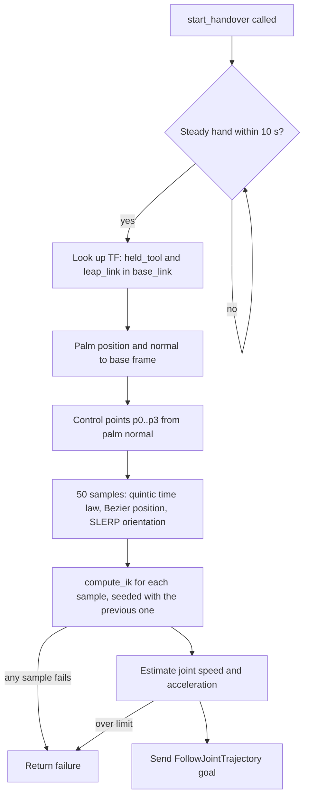

# Handover: start here

> **Owner:** Koa · **Status:** the handover runs on the real UR5e as a standalone service using the commit-once planner. Moving to real-time planning was decided after testing. Real-time planning, task-oriented tool orientation and release on pull are not built yet. · **Reviewed against:** commit `d3010c3`  (2026-11-12)

The handover subsystem moves a tool the robot is already holding into the operator's open hand. It waits until the hand is held steady, plans a smooth curved path that reaches the palm from the palm side, and slows to a stop at the hand. Once built, it will also release the tool when the operator pulls on it.

This page covers what the subsystem does, how it is built, its current limits and what comes next. Details are in the folders listed in [What's in this folder](#whats-in-this-folder).

**Videos:**

- [Bézier handover on the real UR5e](07_data/Handover%20test%20Bezier.mp4): the commit-once planner delivering the tool to a still hand
- [Ultraleap hand tracking in the sim](07_data/Ultraleap%20test%20in%20sim.mp4): the Ultraleap node tested in the simulation environment

## Contents

1. [Requirements it serves](#1-requirements-it-serves)
2. [How it works](#2-how-it-works)
3. [Frames](#3-frames)
4. [Interfaces](#4-interfaces)
5. [Parameters](#5-parameters)
6. [Current limitations](#6-current-limitations)
7. [Future work](#7-future-work)

## 1. Requirements it serves

- **R1**: delivery completed in 15 s or less (target 5 s). The handover is the last motion of a delivery.
- **R2**: successful handoff in at least 80% of trials (target 90%). This subsystem owns the final approach and the release.
- **R6**: hand localization accurate enough for handoff, verified through R2.

These are broken down into handover requirements H1 to H6, with a test plan, in [`01_requirements/`](01_requirements/requirements.md).

## 2. How it works

### Where it sits in the system

The handover runs inside the motion planner node (`handover_motion/planner_node.py`), which will also handle the pickup and dropoff goals (see the [system design](../system/README.md#4-design-decisions)). In the [task statechart](../system/README.md#2-task-state-machine), this subsystem covers `WAIT_FOR_HAND`, `HANDOVER` and `RELEASE`. For now the `start_handover` service (`std_srvs/Trigger`) starts it, because the FSM is not built yet.

To run it, see [`05_code/`](05_code/how-to-run.md).

### Method

The path method follows Biagi et al., *Adaptive vs. Static Robot-to-Human Handover* (2026) [1]. It has three parts:

- **Path shape:** a cubic Bézier curve. Its last segment points along the palm normal, so the tool reaches the hand from the palm side (H4).
- **Timing:** a quintic (fifth-order) time law, so the robot starts and stops with zero speed and acceleration (H3).
- **Tool orientation:** SLERP from the start orientation to the end orientation. It finishes 70% of the way along the path and then holds.

In the paper's user study, this adaptive approach gave lower workload and higher trust than a fixed handover pose. The worked maths and timing bounds are in [`03_calculations/`](03_calculations/path-and-time-law.md).

**These are design choices, not tested decisions.** The method was taken from the paper. It has not been compared with other methods on our robot. The thresholds and scale factors in [section 5](#5-parameters) are tuning values.

The one decision made from testing is the **switch from commit-once to real-time planning**, recorded in [commit-once vs real-time](04_design/commit-once-vs-real-time.md).

### Current algorithm (commit-once)

*Figure 1: Current handover sequence in `planner_node.handover_callback()`.*

The palm pose is read once. After the trajectory is sent the target is fixed, so the robot cannot follow a hand that moves. This is the reason for the switch to real-time planning.

## 3. Frames

| Frame | What it is | Where it comes from |
|---|---|---|
| `base_link` | UR5e base; every target is expressed here | URDF |
| `held_tool` | The tool held on the end effector; tip of the `manipulator` chain | URDF / SRDF (`handover_moveit_config`) |
| `leap_link` | Ultraleap sensor frame on the cell base | URDF (`handover_cell/urdf/workcell.urdf.xacro`) |
| Palm | Operator's palm pose and normal | Ultraleap, published in `leap_link` |

The IK target is the pose of `held_tool`, not the flange, so the path describes where the tool goes.

## 4. Interfaces

| Direction | Type | Name | Interface |
|---|---|---|---|
| In | Topic | `/hand/right` | `handover_interfaces/Hand` (palm pose, normal, velocity, confidence, fingers) |
| In | TF | `base_link → held_tool`, `base_link → leap_link` | `tf2` |
| In | Service (server) | `start_handover` | `std_srvs/Trigger` (temporary; to be replaced by the FSM action goal `HANDOVER`) |
| Out | Service (client) | `compute_ik` | `moveit_msgs/GetPositionIK`, group `manipulator`, `avoid_collisions = true` |
| Out | Action (client) | `/scaled_joint_trajectory_controller/follow_joint_trajectory` | `control_msgs/FollowJointTrajectory` |

`handover_interfaces/srv/ExecuteHandover.srv` exists in the interfaces package, but the planner does not use it yet.

## 5. Parameters

All are hard-coded in `planner_node.py` except `controller_name`. **These are tuning values, not requirements.**

| Parameter | Value | Purpose |
|---|---|---|
| Steady-hand window | 10 messages | Mean palm speed is taken over this many messages |
| Steady-hand speed threshold | 0.05 m/s | Hand counts as steady below this mean speed |
| Max hand message age | 0.2 s | Older data clears the window |
| Steady-hand timeout | 10 s | Per wait attempt |
| Target offset from palm | 0.01 m along palm normal | p₃ |
| α_s | 0.2 m | Start control point scale |
| α_a | 0.2 m (was 2 at commit `d3010c3`) | Approach control point scale; bends the path 0.075 m at its midpoint ([calc §1](03_calculations/path-and-time-law.md#1-how-far-the-control-points-bend-the-path)) |
| Duration T | 2.0 s | Quintic time law; matches the H1 target |
| Samples | 50 | IK and trajectory points |
| Orientation lock | s = 0.7 | SLERP finishes here |
| IK timeout | 0.05 s per call | |

| Controller | `scaled_joint_trajectory_controller` | ROS parameter `controller_name` |

## 6. Current limitations

The commit-once planner delivers the tool to a still hand on the real robot, and the path shape, time law, IK and trajectory execution all work. These are the weak points of the current build:

- **It can't follow a moving hand.** The target is fixed once the trajectory is sent, so if the operator's hand drifts (likely with a no-look grab) the handover fails. See the [decision record](04_design/commit-once-vs-real-time.md#reflection).
- **IK can take longer than the motion.** In the worst case, 50 IK calls at 0.05 s each take 2.5 s before the robot moves, which is more than the 2 s motion. The typical time hasn't been measured. See [calc §3](03_calculations/path-and-time-law.md#3-ik-time-budget).
- **Tool orientation is not adapted.** `q_end = q_start`, so the tool keeps its pickup orientation. The palm-based target is written but commented out, and there is no per-tool grasp offset yet (the paper's H_T_G).
- **There is no release.** Release on pull (H5) is not implemented.

## 7. Future work

| Task | Why | Notes |
|---|---|---|
| Real-time planner, starting with Ruckig | Follow a moving hand ([decision](04_design/commit-once-vs-real-time.md)) | Open questions are in the [decision record](04_design/commit-once-vs-real-time.md#open-questions-for-testing-ruckig) |
| Lower the joint-limit check to the MoveIt values | Catch trajectories the robot can't follow | |
| Palm-based tool orientation with a per-tool grasp offset | Present the handle (H6) | |
| Release on pull | H5 | Pull threshold TBD, must sit above the force sensor noise |
| Abort if the hand is lost or moves too fast; a fallback for the steady-hand wait | Safety (no requirement yet) | System statechart |
| Connect FSM to Handover portion | One node starts all motions | [System README, section 5](../system/README.md#5-implementation-status) |
| Move tuning values to ROS parameters and log them | Tune without editing code; repeatable tests | |

## What's in this folder

| Folder | Contents |
|---|---|
| [`01_requirements/`](01_requirements/) | [Handover requirements and test plan](01_requirements/requirements.md) |
| [`03_calculations/`](03_calculations/) | [Path geometry, time law and timing bounds](03_calculations/path-and-time-law.md) |
| [`04_design/`](04_design/) | [Commit-once vs real-time: decision record and test](04_design/commit-once-vs-real-time.md) |
| [`05_code/`](05_code/) | [Where the code is and how to run it](05_code/how-to-run.md) |
| [`07_data/`](07_data/) | Test videos: [Bézier handover on the real UR5e](07_data/Handover%20test%20Bezier.mp4) · [Ultraleap in the sim](07_data/Ultraleap%20test%20in%20sim.mp4) |
| [`08_references/`](08_references/) | [Papers and datasheets](08_references/references.md) |

## Sources

1. F. Biagi, D. Onfiani, S. Silenzi, C. Iani, L. Biagiotti, "Adaptive vs. Static Robot-to-Human Handover: A Study on Orientation and Approach Direction," arXiv:2604.22378, 2026. Full reference list in [`08_references/`](08_references/references.md).
