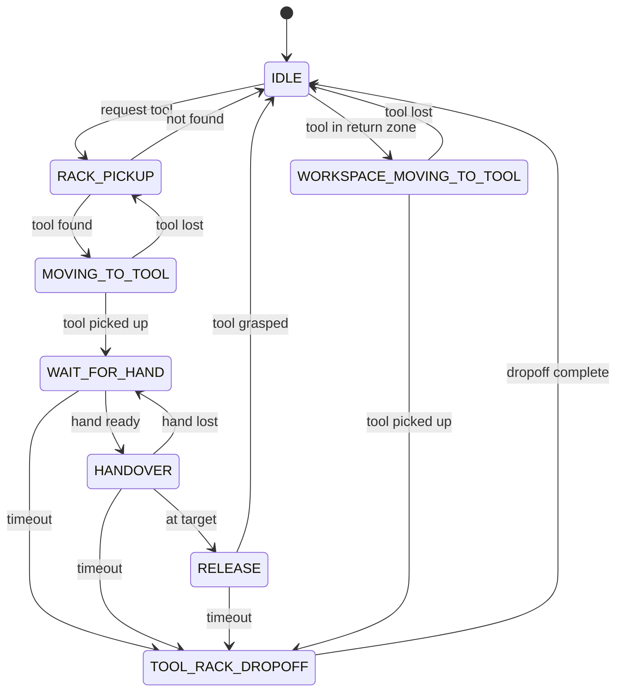
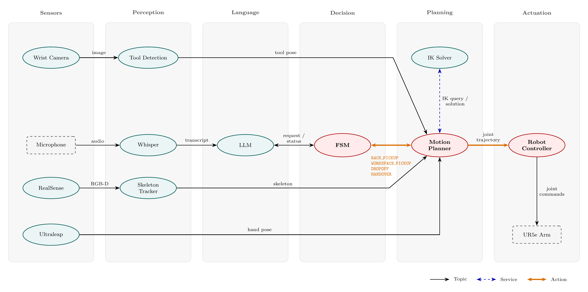

# System Design Overview: Full Handover Cycle
 
> **Status: DESIGN PLAN, not yet implemented.** This page was written before the FSM was built and describes the *intended* system design. The FSM in section 2 does not exist in code yet; see [Implementation status](#5-implementation-status) for what does run today. Items marked **(proposed)** in the tables were added during review of the original sketch and need team sign-off.
>
> **Owner:** TBD · **Reviewed against commit:** `3843731` (2026-11-11)
 
This page covers how the subsystems work together over one complete cycle: a spoken request, picking the tool off the rack, handing it to the operator, and returning tools from the return zone to the rack. Each subsystem's own design is in its own folder (see the [subsystem table](../START_HERE.md#subsystems)).
 
## Contents
 
1. [System behaviour in one paragraph](#1-system-behaviour-in-one-paragraph)
2. [Task state machine](#2-task-state-machine)
3. [ROS 2 node architecture](#3-ros-2-node-architecture)
4. [Design decisions](#4-design-decisions)
5. [Implementation status](#5-implementation-status)
6. [Revision history](#6-revision-history)

---
 
## 1. System behaviour in one paragraph
 
The robot waits in a home pose with the wrist camera looking at the return zone. When the operator asks for a tool, the speech is transcribed and interpreted into a tool ID, and the FSM sends the motion planner to the rack. The wrist camera locates the tool, the arm picks it up with the electromagnetic end effector, and then the robot waits until the operator's hand (tracked by the Ultraleap) is held steady. It then moves toward the hand, continuously updating the target and the tool orientation as the hand moves, holds the tool there until the operator pulls on it, releases the magnet and returns to the home pose. If a tool appears in the return zone while the robot is idle, the robot picks it up and puts it back in its place on the rack.
 
---
 
## 2. Task state machine
 
### 2.1 Statechart
 

 
*Figure 1: Task statechart for the collaborative handover assistant (draft). Source: the Mermaid block above. A separate `.mmd` source and rendered PNG for reports are TBD.*
 
**Stop and fault handling.** From any state, a stop request, protective stop or fault halts motion and goes to `STOPPED`; an operator reset returns the robot to `IDLE`. This rule applies to every state, so it is written here instead of being drawn as an arrow from each one.
 
There are two flows:
 
- **Delivery:** `RACK_PICKUP` → `MOVING_TO_TOOL` → `WAIT_FOR_HAND` → `HANDOVER` → `RELEASE`.
- **Return:** `WORKSPACE_MOVING_TO_TOOL` → `TOOL_RACK_DROPOFF`.

Any delivery that cannot be completed falls back to `TOOL_RACK_DROPOFF`, so the robot never stays holding a tool.
 
### 2.2 States
 
| State | What the robot does | Planner action goal | Leaves on |
|---|---|---|---|
| `IDLE` | Moves to the home pose; wrist camera watches the return zone; listens for requests | none | request tool, tool in return zone |
| `RACK_PICKUP` | Moves to the rack viewing pose and searches for the requested tool | `RACK_PICKUP` (feedback: found / not found) | tool found, tool not found |
| `MOVING_TO_TOOL` | Approaches the tool, energizes the magnet, lifts it off the peg | `RACK_PICKUP` (continues) | tool picked up, tool lost |
| `WAIT_FOR_HAND` | Holds the tool at a staging pose; waits for a steady hand | none | hand ready, timeout |
| `HANDOVER` | Moves the tool to the hand, replanning continuously as the hand moves (Biagi et al. Bézier path with SLERP orientation) | `HANDOVER` (feedback: distance to hand) | at target, hand lost, timeout |
| `RELEASE` | Holds position and watches for the operator's pull; releases the magnet | none (end effector) | tool grasped, timeout |
| `WORKSPACE_MOVING_TO_TOOL` | Picks up a returned tool from the return zone | `WORKSPACE_PICKUP` | tool picked up, tool lost |
| `TOOL_RACK_DROPOFF` | Puts the held tool back on its peg and returns home | `DROPOFF` | dropoff complete |
| `STOPPED` **(proposed)** | Not drawn in Figure 1 (see the stop rule above). Motion halted, magnet state held, waits for an operator reset | cancel all goals | operator reset |
 
### 2.3 Events and guards
 
Each transition needs a well-defined source. Values below come from the code where they exist; **TBD** means no value has been chosen or measured yet.
 
| Event | Source | Condition | Status |
|---|---|---|---|
| request tool | LLM node → FSM | Valid tool ID parsed from the transcript, and FSM is in `IDLE` | Planned |
| tool found / not found / tool lost | Tool detection, reported through `RACK_PICKUP` action feedback | Detection confidence threshold TBD | Planned |
| tool picked up | End effector | Grasp check method TBD | Planned |
| hand ready | Ultraleap `/hand/right` | Mean palm speed of the last 10 samples < 0.05 m/s, every sample newer than 0.2 s | **Implemented** in `planner_node.wait_for_steady_hand()`; values are being tuned |
| hand lost **(proposed)** | Ultraleap `/hand/right` | No hand message for TBD s, confidence below TBD, or hand moves faster than TBD m/s (too fast to follow safely) | Not implemented |
| at target | Robot controller | `FollowJointTrajectory` result is success | Implemented in `planner_node` |
| tool grasped | Force sensor | Pull force above TBD N, then the magnet is switched off | Planned |
| timeout (each state) | FSM timer | `WAIT_FOR_HAND` is 10 s in the current code; all others TBD | Partly |
| tool in return zone | Tool detection (wrist camera at home pose) | Tool detected inside the return-zone region | Planned |
| stop request / protective stop / fault | `stop_handover` service, UR driver safety status, any node error | Any one of these | Service declared only |
 
---
 
## 3. ROS 2 node architecture
 

 
*Figure 2: ROS 2 node architecture by layer. Topics are black, services blue dashed, actions orange. The FSM sends four action goals to the motion planner: `RACK_PICKUP`, `WORKSPACE_PICKUP`, `DROPOFF` and `HANDOVER`.*
 
### 3.1 Nodes
 
| Node | Layer | Package | Status |
|---|---|---|---|
| Wrist camera | Sensors | TBD | Intrinsic calibration done on branch `feature/eye-in-hand-camera`, not merged |
| RealSense D455 | Sensors | `handover_realsense` | Working |
| Ultraleap | Sensors | `handover_hand_tracking` (`leap_node`) | Working |
| Tool detection | Perception | TBD | Not started |
| Whisper | Perception | TBD | Not started |
| Skeleton tracker | Perception | `handover_skeleton_tracking` (`skeleton_node`) | Working (YOLO pose, 17 COCO keypoints) |
| LLM | Language | TBD | Not started |
| FSM | Decision | `handover_orchestrator` (`fsm_node`) | Not started (placeholder package only) |
| Motion planner | Planning | `handover_motion` (`planner_node`) | Handover leg working on the real UR5e |
| IK solver | Planning | MoveIt `move_group` via `handover_moveit_config` | Working |
| Robot controller | Actuation | `ur_robot_driver` | Working |
 
 
### 3.2 Interfaces
 
| From → To | Type | Name | Message / interface | Status |
|---|---|---|---|---|
| Ultraleap → Motion planner | Topic | `/hand/right` (and `/hand/left`) | `hand_msgs/Hand` | Exists |
| Skeleton tracker → Motion planner | Topic | `skeleton/position` | `skeleton_msgs/Skeleton` | Published; not used by the planner yet |
| Wrist camera → Tool detection | Topic | TBD | `sensor_msgs/Image` | Planned |
| Tool detection → Motion planner | Topic | TBD | tool pose, TBD | Planned |
| Whisper → LLM | Topic | TBD | transcript, TBD | Planned |
| LLM ↔ FSM | TBD | TBD | request / status | Planned |
| FSM ↔ Motion planner | Action | TBD | custom action with the 4 goal types | Planned; currently a `Trigger` service `start_handover` |
| Motion planner ↔ IK solver | Service | `compute_ik` | `moveit_msgs/GetPositionIK` (0.05 s timeout) | Exists |
| Motion planner → Robot controller | Action | `/scaled_joint_trajectory_controller/follow_joint_trajectory` | `control_msgs/FollowJointTrajectory` | Exists |
 
---
 
## 4. Design decisions
 
| Decision | Alternatives considered | Why | Record |
|---|---|---|---|
| One motion planner node serves all four goal types | Separate pickup planner and handover planner ([v1 diagram](imgs/ros_node_architecture_v1.png)) | Both planners shared the IK solver, robot controller and skeleton input; one node removes duplicated code and means only one node ever commands the arm. | TBD |
| FSM talks to the planner through actions | Services, topics | Motions are long-running, need feedback (tool found, progress) and must be cancellable for 
| MoveIt used for IK only | MoveIt planners (OMPL, Pilz) | The Bézier/SLERP path from Biagi et al. sets the shape of the handover motion; MoveIt only checks reachability and joint solutions. | TBD |
 

---
 
## 5. Implementation status
 

**FSM: not started.** [`fsm_node.py`](../../src/handover_orchestrator/handover_orchestrator/fsm_node.py) is a placeholder. Its `main()` only prints a message, so the node never spins, and none of the states or transitions in section 2 exist in code.

**What runs today.** The handover leg runs on its own inside [`planner_node.py`](../../src/handover_motion/handover_motion/planner_node.py). Calling the `start_handover` service (`std_srvs/Trigger`) waits for a steady hand on `/hand/right` and then moves the held tool to it. Nothing before or after the handover (speech, LLM, tool pickup, return) is connected.

**Required when the FSM is built:**

- `fsm_node` must subscribe to `/hand/right`, the topic `leap_node` publishes. The placeholder subscribes to `/right/hand`, which nothing publishes.
- `start_handover` must be removed from `planner_node`. The FSM then becomes the only node that starts a motion, and the planner is driven only through the action goals in section 3.2 (FSM ↔ Motion planner row).

---
 

 
## 6. Revision history
 
| Date | Change | By |
|---|---|---|
| 2026-11-10 | First draft: statechart, node architecture | Koa Schuette |

