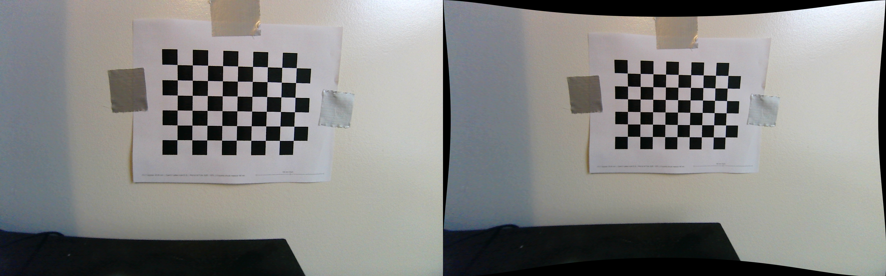
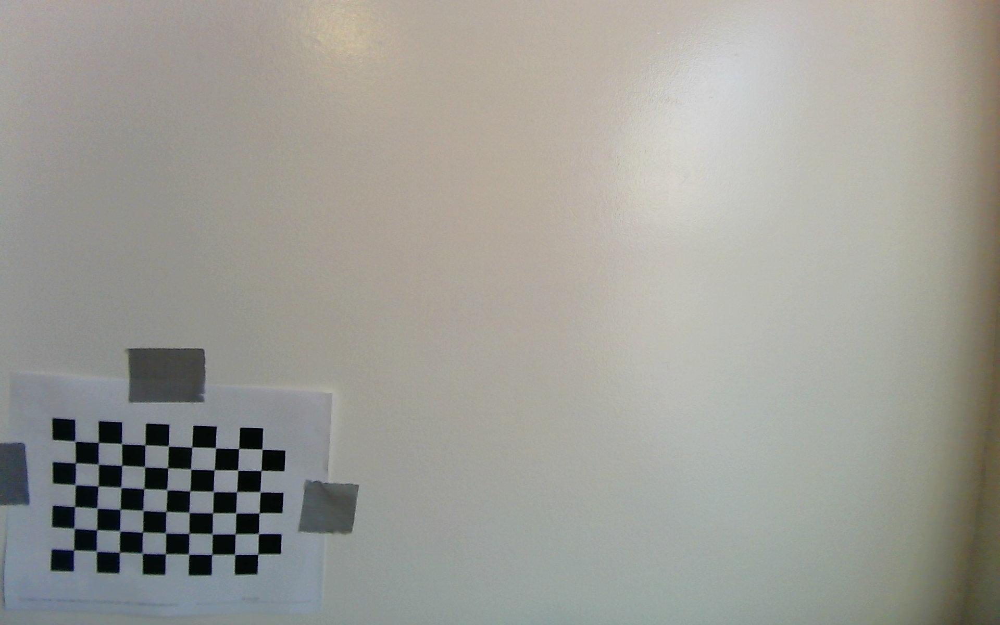

# Eye-in-hand camera: intrinsic calibration

Intrinsic calibration measures the camera's own optics: its focal length, where the optical centre falls on the sensor, and how much the lens distorts the image. Without it, a pixel position can't be turned into a direction from the camera, and every later step (hand-eye calibration, locating a tool on the board) would carry the lens's distortion with it.

*Figure 1. Left: raw image, with the lens's barrel distortion bending the chessboard lines. Right: the same image corrected with the calibrated model. The lines come out straight, and the curved black border is where the corrected image no longer has pixels.*

## Setup

- **Camera:** ELP-USBGS1200P01 (AR0234 sensor, 3.0 µm pixels, global shutter, fixed focus), run at **1920 × 1200**, MJPG.
- **Target:** chessboard of 10 × 7 squares, 20 mm each ([PDF](chessboard_10x7_20mm_letter.pdf)), so OpenCV looks for the 9 × 6 inner corners. It was printed at 100%, and the square size was measured at 20 mm. The board was taped flat to a wall, with the camera held in place.
- **Capture:** USB cameras can't be passed through to WSL2 or the Docker dev container, so images were captured on Windows with Python and OpenCV ([`elp_camera.py`](https://github.com/KoaSchuette/HandoverCapstone/blob/ffa9aff/src/handover_eye_in_hand/calibration/elp_camera.py)), saved into the repo folder, and processed in the container.
- **Calibration:** [`calibrate.py`](https://github.com/KoaSchuette/HandoverCapstone/blob/ffa9aff/src/handover_eye_in_hand/calibration/calibrate.py) finds the chessboard corners in each image and solves for the camera model with OpenCV's `calibrateCamera`. It reports the error for each image and saves the result as a ROS camera_info file.

## Method

The goal is to show the camera the board in as many different positions as possible, because each part of the lens model is pinned down by a different kind of view:

*Figure 2. One calibration image, with the board in the bottom-left corner. Distortion is strongest at the edges, so the board was deliberately placed in every corner and along every edge, as well as tilted at different angles.*

Step-by-step recalibration instructions are in the [calibration README](https://github.com/KoaSchuette/HandoverCapstone/blob/ffa9aff/src/handover_eye_in_hand/calibration/README.md).

The calibration was run **three times**, adding images between runs to improve the corner coverage. The final run used 31 images taken from a range of 0.2 to 0.4 m from the board.

## Results

Final calibration ([`elp_ar0234_1920x1200.yaml`](https://github.com/KoaSchuette/HandoverCapstone/blob/ffa9aff/src/handover_eye_in_hand/config/elp_ar0234_1920x1200.yaml)):

| Value | Result | Meaning |
|---|---|---|
| fx, fy | 716.5, 715.0 px | Focal length in pixels: about 2.15 mm with 3.0 µm pixels |
| cx, cy | 959.7, 524.4 px | Where the optical centre lands on the sensor |
| k1, k2, k3 | −0.0410, −0.0164, 0.0042 | Radial (barrel) distortion |
| p1, p2 | −0.0005, 0.0001 | Tangential distortion (lens tilt), close to zero |
| RMS reprojection error | **0.683 px** | About 0.3 mm on the board at 0.3 m |
| Corner coverage | x 142–1842, y 105–1065 of 1920 × 1200 | The corners reached almost the whole image |

- **Stable across runs:** fx came out at 715.0, 714.6 and 716.5 px across the three runs (a 0.3% spread), and cy was about 525 px every time. Changing the image set barely moved the result, so the calibration doesn’t depend on which images were used.
- **Field of view:** fx and fy give **107° horizontal and 115° diagonal**.

## Anomalies

- **The lens is wider than the product page said.** The page listed a lens with 85° horizontal / 93° diagonal; the measured field of view is 107° / 115°. There's no marking on the lens barrel, so it's probably one of ELP's wider lenses.
- **There's clear barrel distortion despite the "no distortion" listing.** Pixels shift by about 20 px at 600 px from the centre, 100 px at the left and right edges, and 155 px in the corners.
- **The optical centre is about 75 px above the image centre** (cy = 524 vs 600). This showed up in all three runs, so it's a real property of this camera, not noise.
- **Edge images have higher error** (about 1 px vs 0.3–0.5 px near the centre). That's expected for a wide lens with the 5-coefficient model, which can't fully follow the distortion near the edges.
- **Close-up images were rejected.** Five images taken closer than 0.19 m were soft, because the fixed-focus lens is only sharp from about 0.25 m. They were removed before the final run.

## Limitations

- **The undistortion check was only visual** (straight lines come out straight). No separate measurement was made, such as measuring a known distance in a corrected image.
- **The rational distortion model (k4–k6), which handles wide lenses better, wasn't tried.** It might reduce the edge error.
- **The calibration is only valid at 1920 × 1200, and only while the lens isn't touched.** The lens is fixed focus but can be twisted. If it's bumped or adjusted, the calibration has to be redone.

## Looking back

The calibration images were never kept: the image folder is excluded from git, and the blurry images were later deleted. The result can't be re-run from the original data, and the rejected close-ups can't be shown. The images should have gone to the team's shared drive as soon as the calibration was done.

## Files

| File | What it is |
|---|---|
| `undistorted_check.png` | Figure 1: raw vs corrected image, written by `calibrate.py` |
| `calibration_corner.png` | Figure 2: one calibration image |
| `chessboard_10x7_20mm_letter.pdf` | The calibration target. Print at 100% |