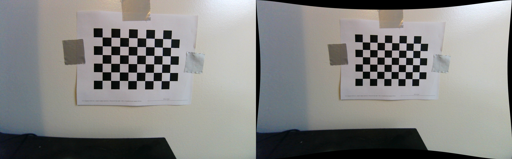

# Tool Pickup

Tool pickup is the rack → robot step: the camera on the robot's wrist finds the requested screwdriver, the robot works out where it is, and the arm picks it up with the electromagnet. The same steps are reused to pick a returned tool up from the return zone on the workbench.

*Figure 1. Eye-in-hand camera calibration check. Left: raw image with barrel distortion. Right: undistorted using the calibrated model; the chessboard lines come out straight.*

## Requirements it serves

- **R5**: correct tool picked up in ≥ 96% of attempts. The camera has to tell the three screwdrivers apart and locate the one requested.
- **R4**: three distinct tools, identified by the camera.

## Pipeline and status

| Stage | What it does | Status |
|---|---|---|
| Camera | ELP AR0234 global-shutter USB camera on the wrist | Selected and received ([camera decision](02_decisions/camera.md)) |
| Intrinsic calibration | Measures the lens (focal length, optical centre, distortion) so pixel positions can be turned into directions | Done ([experiment](06_experiments/intrinsic-calibration/)) |
| Hand-eye calibration | Finds where the camera sits relative to the robot's tool flange | Next |
| Tool detection | YOLO model that finds and identifies each screwdriver in the image | Not started |
| Pixel → robot position | Combines the calibration and the robot's pose to place the tool in the robot's frame | Not started |
| Pickup | Arm moves to the tool and energizes the electromagnet | Not started |

## What's in this folder

| Folder | Contents |
|---|---|
| [`02_decisions/`](02_decisions/) | [Camera](02_decisions/camera.md) |
| [`06_experiments/`](06_experiments/) | [Intrinsic calibration](06_experiments/intrinsic-calibration/) |
| Code | [`src/handover_eye_in_hand/`](https://github.com/KoaSchuette/HandoverCapstone/tree/ffa9aff/src/handover_eye_in_hand): capture and calibration scripts, and the calibration result |

## Next steps

1. Mount the camera on the arm and run hand-eye calibration: fix the chessboard in the cell, then record the robot's pose and a camera image at 15 or more arm positions.
2. Build the screwdriver detection model, then combine it with both calibrations to turn a detection into a pickup target.