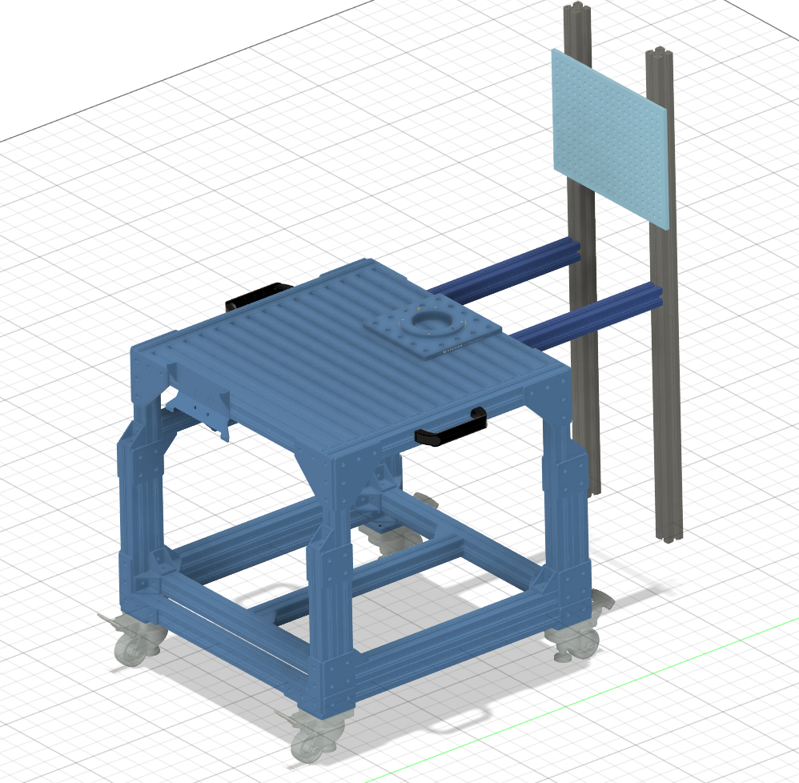

# Tool rack design

*Tool rack CAD (45 mm extrusion, 405 mm arms). A dimensioned drawing will be added once the CAD is updated to the as-built frame.*

The CAD shows 45 mm Vention extrusion and 405 mm arms. The build uses 30 mm extrusion, custom brackets and 35 cm arms (see [frame and brackets](../02_decisions/frame-and-brackets.md) and [adjustable arms](../02_decisions/adjustable-arms.md)).

## Board position in the robot's frame

The robot's tool targets are defined relative to the `pegboard_face` frame in [`handover_cell`](../../../src/handover_cell/): the centre of the board's front face, at (0.005, 0.508, 1.068) m in the CAD. With the arms set at 35 cm, the board is about 55 mm closer to the robot (y ≈ 0.453 m). If the board moves, this frame has to be updated to match, using the `PEGBOARD_OFFSET` setting.

Frame: origin on the floor under the robot plate, +X right, +Y toward the pegboard, +Z up.

## Interfaces

| Connects to | What has to match |
|---|---|
| Robot cart | 30 mm arms clamp into the cart’s 45 mm extrusion through custom angle brackets; the uprights slide along the arms until the position is final |
| End effector | Each tool hangs with its steel end exposed for the electromagnet (25 mm face radius) |
| Eye-in-hand camera | The whole board must be in view from the observation pose; the camera is in focus from about 0.25 m |

## Files

| File | What it is |
|---|---|
| `Capstone Assembly Actual.step` | Full cell CAD (Fusion export, mm) |
| [`BOM.md`](BOM.md) | Rack parts, suppliers and costs |