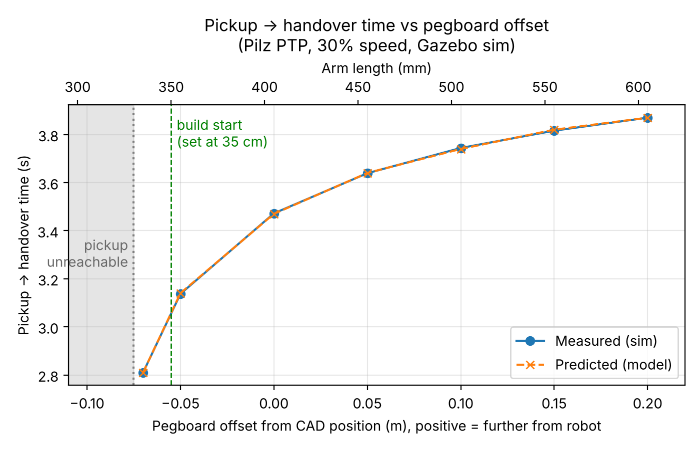

# Pegboard distance study

How does the pegboard's distance from the robot change the pickup to handover time, and how close can it go? The board sits on adjustable arms (see [adjustable arms](../../02_decisions/adjustable-arms.md)), so this study set where to start them. It feeds requirement **R1** (delivery and return each ≤ 15 s).


*Figure 1. Measured and predicted pickup to handover time against board offset. Shaded: pickup unreachable. Top axis: the arm length that gives each offset (405 mm + offset).*

## Prediction (made before the runs)

Pilz PTP times each move by the joint that turns furthest, using a trapezoidal velocity profile at 30% of the joint limits. Worked calculation: [PTP timing worksheet](../../03_calculations/ptp_timing_prediction.pdf).

| Offset (m) | −0.05 | 0 | +0.05 | +0.10 | +0.15 |
|---|---|---|---|---|---|
| Predicted (s) | 3.14 | 3.47 | 3.64 | 3.74 | 3.82 |

## Method

- **Sim:** the full Gazebo + MoveIt cell ([`handover_cell`](https://github.com/KoaSchuette/HandoverCapstone/tree/9269faa/src/handover_cell)), relaunched for each offset with the board moved in the model:
  ```bash
  PEGBOARD_OFFSET=0.1 ros2 launch handover_cell cell_sim.launch.py
  PEGBOARD_OFFSET=0.1 ros2 run handover_cell handover_demo.py
  ```
- **Script:** [`handover_demo.py`](https://github.com/KoaSchuette/HandoverCapstone/blob/9269faa/src/handover_cell/scripts/handover_demo.py) sends three joint goals (pickup → handover → return) with Pilz PTP at 30% speed, executes each, and logs the time and the slowest joint to a CSV.
- **Pickup pose:** tool 20 cm in front of the board centre, facing it. Joint angles for each offset came from an offline IK model and were checked in the sim with `tf2_echo pegboard_face tool0`, which reads (0, −0.200, 0).
- **Handover pose:** fixed for every offset (joint values in the script).
- **Offsets:** −0.10 to +0.15 m in 5 cm steps, plus attempts at −0.07 and +0.20 m. Runs on Oct 27; re-run on Oct 28 with the return leg added.

## Results

| Offset (m) | Arm length | Handover (s) | Return (s) | Slowest joint |
|---|---|---|---|---|
| −0.10 | 305 mm | unreachable | | |
| −0.07 | 335 mm | re-run planned | | |
| −0.05 | 355 mm | 3.137 | 3.137 | shoulder pan, 135.5° |
| 0 | 405 mm | 3.472 | 3.472 | shoulder pan, 153.6° |
| +0.05 | 455 mm | 3.639 | 3.639 | shoulder pan, 162.6° |
| +0.10 | 505 mm | 3.744 | 3.743 | shoulder pan, 168.2° |
| +0.15 | 555 mm | 3.816 | 3.816 | shoulder pan, 172.2° |
| +0.20 | 605 mm | re-run planned | | |

Data: [`cycle_times.csv`](cycle_times.csv), cleaned from the raw log: pickup-leg rows removed, and the speed scale (0.3) and planner (PTP) columns dropped because they were the same for every run. The raw log is kept in the repo history at [commit `9269faa`](https://github.com/KoaSchuette/HandoverCapstone/blob/9269faa/cycle_times.csv).

- **Every measured time is within 0.005 s of the prediction.** The timing model fully explains the result: a closer board means less base rotation to reach the operator.
- **Return = handover** at every offset. PTP time depends only on how far each joint turns, which is the same in both directions. That's a sanity check that passed.
- **Per tool delivered and returned,** the moves take 6.27 s at −0.05 m and 7.63 s at +0.15 m. Moving 20 cm costs 1.36 s per tool.
- **The gain shrinks with distance:** 0.34, 0.17, 0.11 and 0.07 s per 5 cm step.
- **−0.07 and +0.20 m are still to be tested.** The first attempt stopped before planning, because the script had no pickup angles for these offsets. A re-run with angles added is planned.

## The reach limit

Closer than about **−0.075 m**, the pickup pose is impossible. The UR5e's wrist sits 0.133 m sideways from the arm's base axis (the d4 offset), so the wrist can never come closer to the base than that. As the board approaches, the wrist is pushed toward that limit:

| Offset (m) | 0 | −0.05 | −0.07 | −0.075 | −0.10 |
|---|---|---|---|---|---|
| Wrist distance from base axis (m) | 0.208 | 0.158 | 0.138 | 0.133 (limit) | 0.108 (impossible) |

Confirmed in the sim at −0.10 m: a direct IK request returned error −31 (no solution). The pickup angles also show the limit coming. The base angle changes 3.9°, 5.7°, 9.0° and then 18.1° per 5 cm step as the board moves closer, and joints moving faster and faster for the same tool movement is the signature of an approaching singularity.

## What didn't match: the first prediction

An earlier, rougher model assumed full speed, a 15 cm pickup standoff and a different handover pose. It predicted that **−0.10 m would be fastest** and that **wrist 2** would be the slowest joint. Both were wrong: −0.10 m is past the reach limit, and with the real handover pose the base rotation dominates. Rebuilding the model with the actual poses and speed is what made the second prediction accurate.

## Limitations

- **5 cm steps.** Nothing was tested between −0.05 m and the −0.075 m limit, and the 35 cm build start (−0.055 m) falls in that gap.
- **One pickup standoff (20 cm).** The reach limit depends on it; a different camera observation pose would move the limit.
- **Sim only, one planner, 30% speed.** The times don't convert directly to 100%, because the acceleration ramps don't scale linearly. Payload isn't modelled.
- **The offset setting isn't in the repo yet.** The `PEGBOARD_OFFSET` change that moves the board in the model was used for these runs but hasn't been pushed, so the study can't be reproduced from the repo until it is.

## Decision

Start the arms at 35 cm, the fastest region with about 2 cm of margin to the reach limit, and keep them adjustable until the real robot and the camera confirm it. See [adjustable arms](../../02_decisions/adjustable-arms.md).

## Looking back

The pickup angles were a hand-made table, one row per offset. That was simple to build, but it's why −0.07 and +0.20 m couldn't be run. Defining the pickup as a pose relative to the board, and letting MoveIt solve the angles, would have let us test any offset, including finer steps near the limit. We'd also push the offset code together with the data, so the study can be reproduced from the repo.

## Files

| File | What it is |
|---|---|
| [`cycle_times.csv`](cycle_times.csv) | Cleaned study data |
| [`plot_times.py`](plot_times.py) | Makes Figure 1 from `cycle_times.csv`: `python3 plot_times.py` |
| `time_vs_offset.png` | Figure 1 |
| [`handover_demo.py`](https://github.com/KoaSchuette/HandoverCapstone/blob/9269faa/src/handover_cell/scripts/handover_demo.py) | Script that ran the study |
