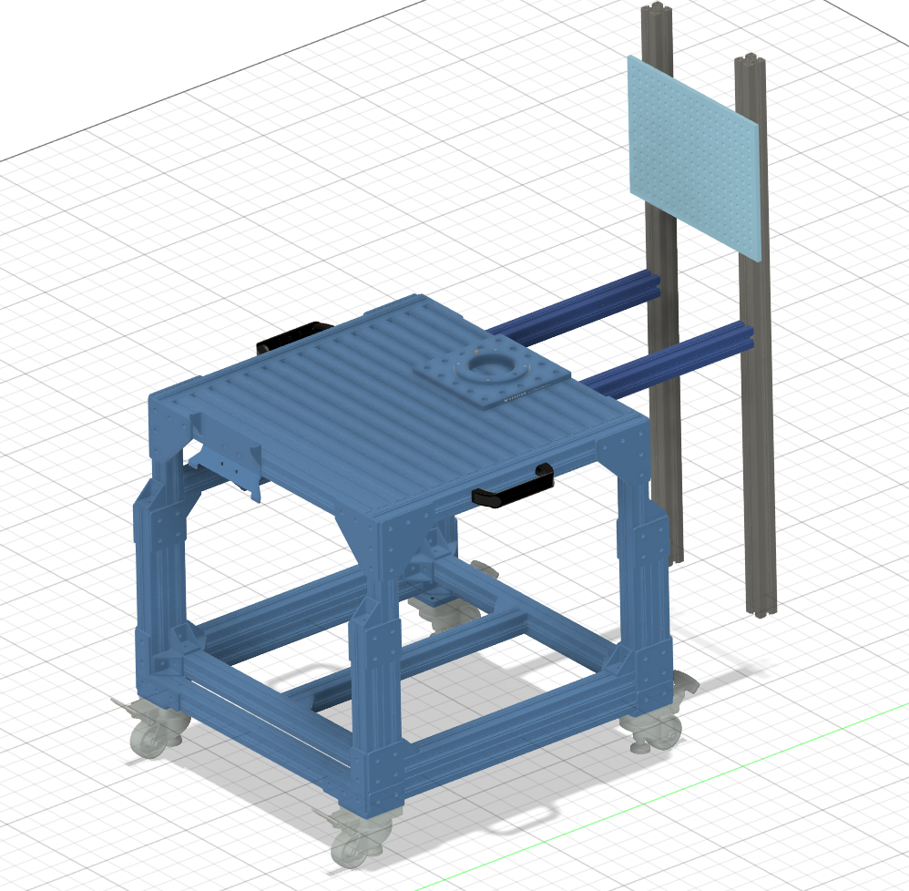

# Tool Rack

The tool rack holds the three screwdrivers at fixed, known positions so the UR5e can pick them up without searching for them. It is a pegboard on an aluminium frame that bolts to the back of the robot cart. Because the board's position comes from the CAD model, every tool slot is a known point in the robot's frame before any camera is used.

*Figure 1. CAD of tool rack without UR5e showing pegboard and extrusions*

## Requirements it serves

- **R4**: three distinct tools, each with its own fixed slot.
- **R5**: correct tool picked up in ≥ 96% of attempts. Fixed slots mean the arm goes to a known pose, and the camera only confirms which tool is there.
- **R1**: delivery and return each ≤ 15 s. Board distance affects pickup → handover time; see [exp-001](../simulation/06_experiments/pegboard-distance/).

## What's in this folder

| Folder | Contents |
|---|---|
| [`02_decisions/`](02_decisions/) | [Pegboard](02_decisions/pegboard.md) · [Fixed position](02_decisions/fixed-position.md) · [Frame and brackets](02_decisions/frame-and-brackets.md) · [Adjustable arms](02_decisions/adjustable-arms.md) |
| [`03_calculations/`](03_calculations/) | Reach check and arm-length worksheets |
| [`04_design/`](04_design/) | Key dimensions, interfaces, CAD (STEP + Onshape), BOM |
| [`06_experiments/`](06_experiments/pegboard-distance) | Expirements run for calculations |
| Code | [`src/handover_cell/`](../../src/handover_cell/): cell model with the pegboard frame and the `pegboard_face` frame the robot targets; [`handover_demo.py`](../../src/handover_cell/scripts/handover_demo.py): the script that ran the distance study |

## Open issues

- **Reach margin.** The arms start at 35 cm, the fastest position in exp-001. The sim reached the board at −0.05 m. -0.07 m was tested and works, but the arm is folded almost back on itself there, and the sim has no gripper or camera on the wrist. Re-check in the sim before final cuts.
- **The CAD doesn't match the build.** The CAD uses 45 mm uprights and 405 mm arms; the build uses 30 mm extrusion, custom brackets, and longer arms set at 35 cm until the final length is chosen. Update the CAD and the sim meshes once the frame is built.
- **The fabrication milestone slipped** from Oct 30. We waited for the ordered parts to arrive so we could confirm the build before starting any 3D prints. The brackets join two different extrusion sizes, so printing them early risked reprinting if the parts didn’t match the CAD. The hooks and brackets are printed once the frame parts are in.

## Next steps

1. Finish the brackets and assemble the frame with the board at 35 cm.
2. 3D print the hooks and fix the slot positions.
3. Measure the as-built position against the CAD.
4. Adjust the arm length if the camera needs a different view of the tools, then cut the arms to that length.
