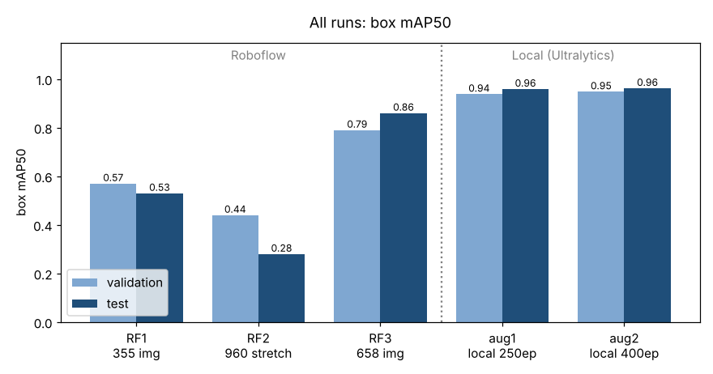
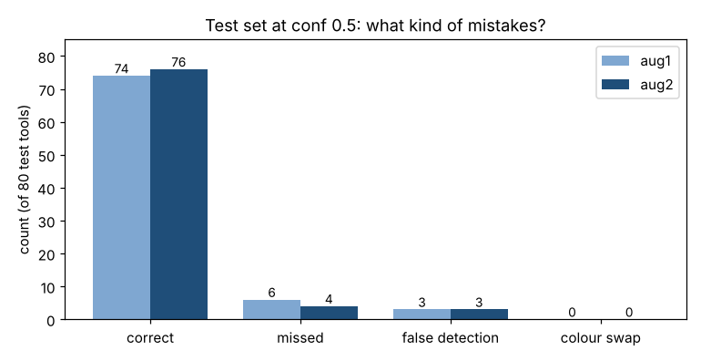
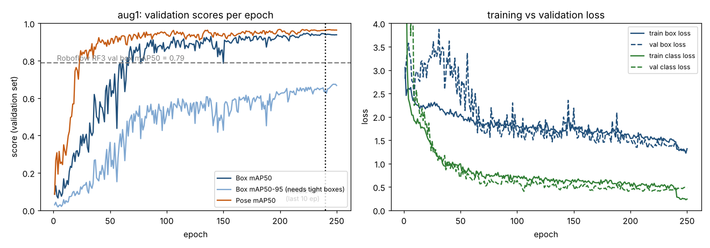
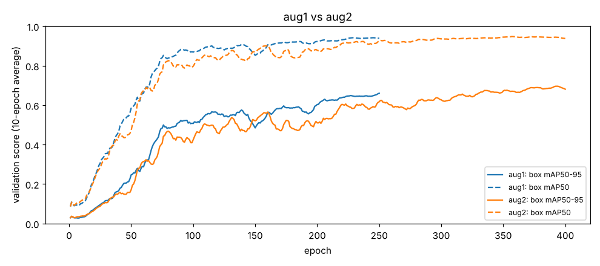

# Screwdriver keypoint model: training runs

Log of every training run for the tool-detection model. One entry per run: what changed, why, and the result.
Rule: change one or two things per run, and compare runs on the **same validation set**. Check the test set only to compare finished candidates.

## Setup (fixed for all runs unless noted)

- **Task:** YOLO pose (keypoint detection). Classes: Blue / Green / Red Screwdriver (ids 0 / 1 / 2, alphabetical from Roboflow).
- **Keypoints:** handle_end, junction, tip. `flip_idx: [0, 1, 2]` (no left/right pairs). Occluded points labelled with v = 1 at best-estimate position; out-of-frame points removed (v = 0).
- **Model:** YOLO26s-pose (`yolo26s-pose.pt`, COCO-pretrained), imgsz 640, batch 16.
- **Ultralytics default augmentation (on unless changed):** fliplr 0.5, mosaic 1.0 (off for the last 10 epochs), scale 0.5, translate 0.1, hsv_h 0.015, hsv_s 0.7, hsv_v 0.4.
- **What matters for the robot:** correct colour and accurate junction/tip on close-up single-tool images. Colour swaps are the critical error (wrong tool handed over); misses and false detections cost time.
- **Pose mAP is lenient** for custom skeletons (default keypoint sigmas), so pose mAP50 ≈ pose mAP50-95. Use box metrics and the confusion matrix to compare runs.

### Environment (dev container, RTX 3060 Ti 8 GB, WSL2)
- Ultralytics 8.4.183, torch 2.14.1 + CUDA 13.0.
- Run everything from `src/handover_tool_detection/training/`.
- **Prefix every train/val command with `PIN_MEMORY=False` and add `workers=2`.** With 8 workers and pinned memory, WSL2 runs out of pinned host RAM (`CUDA_ERROR_OUT_OF_MEMORY from cuMemHostAlloc`) even though the GPU uses only ~4.8 GB.
- Don't pass `project=`: results already go to `runs/pose/<name>/`.

### Dataset (not in git)
- Roboflow project `handover-capstone/capstone-keypoint-detection`, export **v4**, format YOLOv8, unzipped to `datasets/screwdriver_v4/`.
- 658 images: 461 train / 132 valid / 65 test. Valid: 146 tools (B47 G59 R40). Test: 80 tools (B26 G28 R26). 52 null images.
- **After unzipping, edit `data.yaml`:** Roboflow's `../` paths resolve to the wrong folder. Replace the first lines with:
  ```yaml
  path: /workspaces/HandoverCapstone/src/handover_tool_detection/training/datasets/screwdriver_v4
  train: train/images
  val: valid/images
  test: test/images
  ```
- Label audit (`audit_labels.py`, 2026-11-24): no swapped point orders, no points outside boxes; 10 points on the image edge, 2 box pairs overlapping ~64% (crossed tools).

## Commands

Run from `src/handover_tool_detection/training/` inside the dev container. Replace `<name>` with the run name (e.g. `aug3`).

| What | Command |
|---|---|
| Check the labels | `python3 audit_labels.py datasets/screwdriver_v4` |
| Train | `PIN_MEMORY=False yolo pose train data=datasets/screwdriver_v4/data.yaml model=yolo26s-pose.pt imgsz=640 epochs=400 patience=100 batch=16 workers=2 flipud=0.5 degrees=180 hsv_s=0.3 name=<name>` |
| Score on the test set (mAP) | `PIN_MEMORY=False yolo pose val model=runs/pose/<name>/weights/best.pt data=datasets/screwdriver_v4/data.yaml split=test workers=2 name=<name>_test` |
| Test-set confusion matrix at robot-like confidence | same as above plus `conf=0.5`, with `name=<name>_test_c50`. **Use only its confusion matrix**; its mAP reads low because of the cutoff |
| Draw predictions on images | `yolo pose predict model=runs/pose/<name>/weights/best.pt source=datasets/screwdriver_v4/test/images conf=0.5 name=<name>_pred` |
| Compare runs' curves | `python3 plot_runs.py aug1 aug2 <name>` → `figures/compare_aug1_aug2_<name>.png` |
| Check the Ultralytics version | `pip show ultralytics` (YOLO26 needs ≥ 8.4) |

Each run folder `runs/pose/<name>/` contains `weights/best.pt` (best epoch on validation), `weights/last.pt`, `args.yaml` (every setting used), `results.csv` (per-epoch metrics), `confusion_matrix.png`, and `val_batch*_labels.jpg` / `val_batch*_pred.jpg` (labels vs predictions on the same images).

## Figures

All runs, box mAP50 on validation and test:



What kind of mistakes the local models make on the test set at conf 0.5:



aug1 training curves (left: validation scores, right: training vs validation loss):



aug1 vs aug2 (10-epoch average): aug2 learns more slowly mid-run, then overtakes once its schedule winds down:



## Roboflow runs (history)

| Run | Data | Settings | Val box mAP50 | Test box mAP50 | Notes |
|---|---|---|---|---|---|
| RF1 | v2, 355 img | YOLO26s, 640 Fit (black edges), brightness ±15% / exposure ±10% / noise, 300 ep | 57% | 53% | Plateau ~epoch 45. Roboflow's viewer draws predictions in the wrong place with Fit (letterbox coordinates not undone) |
| RF2 | v2, 355 img | 960 **Stretch**, 200 ep, patience 40 | 44% | 28% | Worse. Two changes at once, so cause unclear (likely Stretch distortion + 960 with little data) |
| RF3 | v4, 658 img | Same as RF1 | 79% | 86% | More data was the big lever. Test at 22% conf: 16 of 23 errors were misses, green worst |

Roboflow limitations: no flips/rotation/crop/mosaic for keypoint projects; training costs credits (~0.6–0.9 per run).

## Local runs (dataset v4)

### aug1 (2026-11-24)
- **Command:**
  `PIN_MEMORY=False yolo pose train data=datasets/screwdriver_v4/data.yaml model=yolo26s-pose.pt imgsz=640 epochs=250 patience=45 batch=16 workers=2 flipud=0.5 degrees=180 hsv_s=0.3 name=aug1`
- **Changes vs defaults:** flipud 0.5, degrees 180, hsv_s 0.3; epochs 250, patience 45.
- **Why:** add the rotations and vertical flips Roboflow blocked (tools can point any way on the bench); lower saturation jitter to protect the colour classes.
- **Validation:** box mAP50 0.938, mAP50-95 0.673, P 0.956, R 0.892. Pose mAP50 0.964. Per class box mAP50 B 0.954 / G 0.923 / R 0.939. Green recall 0.847 (weakest).
- **Test:** box mAP50 0.959 (B 0.95 / G 0.962 / R 0.965), P 0.979, R 0.925.
- **Test at conf 0.5 (confusion matrix):** 74/80 correct, 6 misses (B3 G2 R1), 3 false detections (1 blue, 2 green), **0 colour swaps**.
- **Training:** ran all 250 epochs (patience never triggered), best ~epoch 247, 36 min. Passed RF3's 79% at epoch 61. Train and val loss track each other (no overfitting). Still improving slowly at the end.
- **Note:** the confusion matrix from a plain `val` run is computed at conf ~0.001 and is full of low-confidence noise. Use `conf=0.5` for a deployment-like matrix.
- **Next change:** longer schedule (still improving at the end).

### aug2 (2026-11-24): CHOSEN MODEL
- **Command:**
  `PIN_MEMORY=False yolo pose train data=datasets/screwdriver_v4/data.yaml model=yolo26s-pose.pt imgsz=640 epochs=400 patience=100 batch=16 workers=2 flipud=0.5 degrees=180 hsv_s=0.3 name=aug2`
- **Change vs aug1:** epochs 250 → 400, patience 45 → 100. Everything else the same.
- **Why:** aug1 was still improving at the end. Note: Ultralytics plans the learning-rate decay and the mosaic-off phase around `epochs`, so choose a length you expect to finish rather than a huge number cut short by patience.
- **Validation:** box mAP50 0.948, mAP50-95 0.707, P 0.962, R 0.914. Pose mAP50 0.969. Per class box mAP50 B 0.965 / G 0.939 / R 0.939. Green recall 0.898.
- **Test:** box mAP50 0.962, mAP50-95 0.766, P 0.955, R 0.961.
- **Test at conf 0.5 (confusion matrix):** 76/80 correct, 4 misses (B1 G2 R1), 3 false detections (**all labelled green**), **0 colour swaps**.
- **Training:** ran all 400 epochs, best ~epoch 390, 58 min, 4.3 ms inference per image. Learned slower than aug1 mid-run (higher learning rate for longer) and overtook it at the end. mAP50 flat after ~epoch 300; mAP50-95 still creeping up slightly.
- **Decision:** aug2 `runs/pose/aug2/weights/best.pt` is the model to use. More epochs is now a weak lever.
- **Caveat:** 0 swaps in 80 test tools means the true swap rate could still be up to ~4% (rule of three). Needs more trials on the arm.

## Open items / ideas for later runs
- The 3 false detections are all "green". Look at them (`yolo pose predict ... source=datasets/screwdriver_v4/test/images conf=0.5`) and add null photos of whatever triggers them.
- Possible single changes if needed: model size s → m; imgsz 640 → 800 (keep letterbox).
- Robot-relevant evaluation still to do: colour accuracy and junction pixel error on close-up single-tool images.
- Copy the chosen weights into the package (e.g. `models/screwdriver_pose_aug2.pt`) when the ROS node is written; agree with the team whether the ~20 MB file goes in git.
